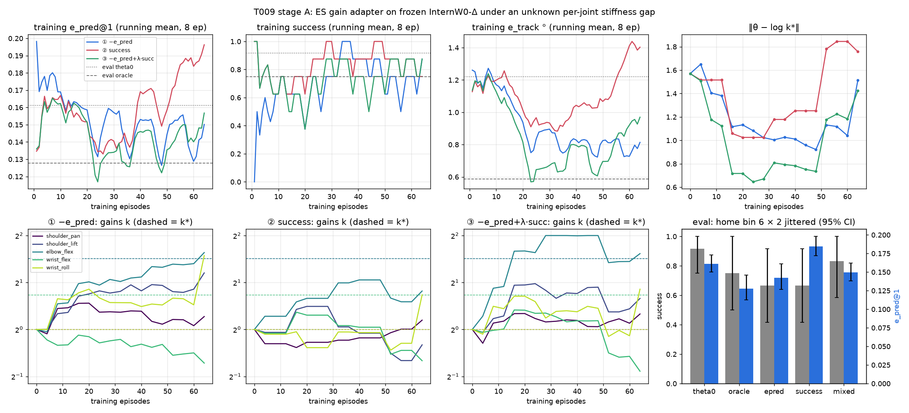

# T009: RL rehearsal in sim (H2-P1 stage A): ES gain adapter on frozen InternW0-Δ, three rewards

Branch `exp/wam-rl-sim` (from `wam-control-gap` 6b104b0). Outputs `/outputs/so101-playground/runs/T009/`
(`queue/done/*.json` = one result per episode, `episodes/*.npz` = per-tick cmd/sent/q, `es/<method>.jsonl` = one
line per ES update, `server/`, `logs/`, `analysis.md`, `summary.json`, `gpu_time.log`). Rows in
`/outputs/so101-playground/results.tsv`: `T009-<method>-train`, `T009-<method>-eval`, `T009-baseline-theta0`,
`T009-oracle`. Figure `docs/T009_rl_sim.png`.

## Question

Can a tiny command adapter on top of frozen InternW0-Δ learn to undo an **unknown** stiffness gap from episode
rewards alone, at a real-robot episode budget? Three rewards at the same budget:
① −e_pred only (the hypothesis; success is only logged), ② success only (baseline), ③ −e_pred + λ·success.
Does ① recover the arm and move θ toward the oracle, faster than ②? Does ③ beat both? Any reward hacking?

Scenes follow the lead's amendment (2026-11-23): stage A must match the planned real-robot stage C. Training and
eval therefore both use the **6 home-object bin layouts**, with human re-placement error simulated per episode.

## Design (identical for ①②③ except the reward)

**Gap, unknown to the learner, fixed for the run** (`control_gap.py`, condition `gainj`): arm PD stiffness ×
(shoulder_pan 1.0, shoulder_lift 0.35, elbow_flex 0.35, wrist_flex 0.6, wrist_roll 1.0); damping and Jaw nominal.
Measured actuator stiffness: Rotation 55, Pitch 10.5, Elbow 8.75, Wrist_Pitch 7.2, Wrist_Roll 7, Jaw 2. Oracle
gains k* = 1/s = (1, 2.857, 2.857, 1.667, 1); log k* = (0, 1.050, 1.050, 0.511, 0); ‖log k*‖ = 1.57.

**Adapter** (`gain_adapter.py`), where T005's oracle acts, after the client's 15°/tick clamp and before the gap:

    policy chunk → client clamp → cmd → sent = q + k⊙(cmd − q) (5 arm joints) → gap → env.step

with q the measured joint position the client clamped against. θ = log k ∈ R⁵, θ₀ = 0, k clipped to [0.5, 4].
No offsets. θ = log k* is exactly the T005 gain oracle at α = 1, per joint.

**Optimizer** (`t009_es.py`): episodic antithetic ES.
- Pair p: εₚ ~ N(0, I₅), δₚ = σεₚ with σ = 0.2 (log-k). Members θ+δₚ and θ−δₚ (each clipped to the k range).
  Both run home bin layout row p mod 6 with the same episode id; each member gets its own layout jitter.
- dₚ = R(θ+δₚ) − R(θ−δₚ). Ties give 0, and so does a missing reward (never happened).
- **Update every 2 pairs:**
  - scale = RMS of all d so far in this run, including this batch;
  - sₚ = clip(dₚ/scale, −3, 3), with s = 0 if scale = 0;
  - g = mean over the 2 pairs of sₚεₚ;
  - θ ← clip(θ + η·g), with η = 0.2.
- 32 pairs = 64 episodes = 16 updates per method.
- **Common random numbers.** εₚ, the jitter draws and the episode ids depend only on p. The three methods
  therefore see the same perturbation and placement sequence and differ only through θ and the reward.
- Workers: 2 Isaac clients take episodes from a shared file queue (`scripts/t009_worker.py`). Training jobs go
  first, ordered by pair index, so the three methods advance together. Eval jobs fill gaps.

**Rewards** (episode level, both are computable on a real robot):
- ① R = −mean over queries of e_pred@1.
- ② R = success (0/1).
- ③ R = −e_pred + λ·success, with λ = 0.05.

e_pred@1 is InternW0-Δ's latent-1 prediction error (Wan2.2 VAE latent MSE, ticks 4–16 after each query; T006).
The client sends the observed frames at s+4…s+16 to `/iw_score` at s+16. The terminating tick is not scored.

**λ.** In T006 (oracle, gain2) the per-episode e_pred differences between α=1 and α=1.5 on the same layouts had a
median |Δ| of 0.026 (mean 0.029). That contrast is 0.32 in log-k on every arm joint, about the size of the 2δ
difference inside a pair (2σ = 0.4 per joint). none vs α=1 (≈ noise) gave 0.006. λ = 2 × 0.026 ≈ 0.05 was fixed
before the run.

**Scenes (amendment).**
- Training cycles the 6 home-object bin layouts (`tasks/home_objects.jsonl` rows 0–5 with
  `tasks/layouts/home_objects_layouts.jsonl`): black pen, black remote, blue paintbrush, red pen, purple
  toothbrush, razor.
- **Human re-placement error:** every episode independently shifts the object by dx, dy ~ U(−1, 1) cm and
  rotates it by dyaw ~ U(−5°, 5°) about z. The two members of a pair are re-placed independently.
- Env seed 1984 per worker process, as in T004–T007. The object pool (both episode sets, 14 objects) is the same
  in every worker.

**Policy noise is fixed by the model.** InternW0-Δ's online policy builds `torch.Generator(...).manual_seed(seed)`
on every denoising call (`InternW0-Delta/src/wam/inference/online_action_policy.py`). Identical inputs therefore
give identical actions, whatever the episode id (checked: max |Δaction| = 0 for two different episode ids). The
planned per-query server seeding (`--seed_per_query`) is a no-op for this model. Within a pair, the policy
receives exactly the same noise. What differs is θ, the jitter, and physics/render nondeterminism: two
unjittered θ0 smoke episodes on the same layout already differed by 0.3° in the first chunk and by ~5° after
100 ticks. **A real-robot server with the same seeded generator is in the same situation.**

**Eval** (no exploration noise):
- Settings: θ = 0 (gap, no adapter), θ = log k*, and the final θ of ①, ② and ③.
- Episodes: the 6 home bin layouts × 2 jittered repeats = 12 per θ. The jitter of (row, repeat) and the episode
  id are the same for every θ, so the deltas vs θ0 are paired.
- Jitter-noise check: 3 unjittered θ0 pairs (rows 0, 2, 4, two identical runs each). These are compared with the
  jittered θ0 repeats (same row, same episode id, independent jitter).
- Metrics: success, e_track (mean |cmd − q(t+1)| over the arm joints and policy ticks, cmd before adapter and
  gap), raw e_pred@1, arm path length (Σ|Δq| over the arm joints), ticks. CIs are 95% bootstrap over episodes.

**Hacking checks.** Each episode logs arm path length, episode length, success and e_track. A method is flagged
if its e_pred improves while success or motion drops, at eval (paired vs θ0) or between the first and last 16
training episodes.

## Results



All numbers are from `analysis.md` / `summary.json`. Every planned episode ran: 3 × 64 training, 5 × 12 eval and
6 no-jitter, 258 episodes in total. No worker crashed, no job was requeued, and no query was missing its score.

### Eval (home bin 6 layouts × 2 jittered repeats, no exploration noise)

CIs are 95% bootstrap over episodes. Δ vs θ0 is paired by (layout, repeat): every θ got the same jitter.

| θ | k (pan, lift, elbow, wflex, roll) | success | e_track ° | e_pred@1 | Δe_pred vs θ0 | Δsuccess vs θ0 | arm path ° | ticks |
|---|---|---|---|---|---|---|---|---|
| θ0 (gap, no adapter) | 1, 1, 1, 1, 1 | 11/12, 0.92 [0.75, 1.00] | 1.22 [1.19, 1.25] | 0.161 [0.150, 0.173] | — | — | 1255 | 598 |
| oracle | 1, 2.86, 2.86, 1.67, 1 | 9/12, 0.75 [0.50, 1.00] | **0.59** [0.50, 0.71] | **0.128** [0.113, 0.146] | **−0.033** [−0.055, −0.009] | −0.17 [−0.42, 0] | 1254 | 612 |
| ① −e_pred | 1.21, 2.30, 3.11, 0.61, 2.98 | 8/12, 0.67 [0.42, 0.92] | 0.68 [0.59, 0.80] | 0.142 [0.127, 0.161] | −0.019 [−0.039, +0.005] | −0.25 [−0.58, +0.08] | 1292 | 652 |
| ② success | 1.15, 0.80, 1.76, 0.63, 1.67 | 8/12, 0.67 [0.42, 0.92] | 1.21 [1.18, 1.23] | 0.185 [0.172, 0.198] | +0.024 [+0.010, +0.039] | −0.25 [−0.58, +0.08] | 1284 | 668 |
| ③ −e_pred + λ·succ | 1.26, 1.58, 3.06, 0.54, 1.81 | 10/12, 0.83 [0.58, 1.00] | 0.82 [0.77, 0.88] | 0.149 [0.138, 0.162] | −0.012 [−0.025, +0.004] | −0.08 [−0.25, 0] | 1266 | 618 |

Per layout (S = success, T = 30 s timeout; repeat 0, repeat 1). The other failure kind never occurred.

| layout | θ0 | oracle | ① | ② | ③ | training success (all methods) |
|---|---|---|---|---|---|---|
| black pen | SS | TT | TT | TT | ST | 0.44 |
| black remote | SS | SS | SS | SS | SS | 0.81 |
| blue paintbrush | SS | SS | SS | SS | SS | 0.97 |
| red pen | TS | TS | ST | ST | TS | 0.37 |
| purple toothbrush | SS | SS | TS | ST | SS | 1.00 |
| razor | SS | SS | SS | SS | SS | 1.00 |

- **e_pred ranks the five θ exactly as e_track does:** oracle 0.128 < ① 0.142 < ③ 0.149 < θ0 0.161 < ② 0.185,
  and e_track 0.59 < 0.68 < 0.82 < 1.22 ≈ 1.21. Its minimum sits at the oracle (−0.033 vs θ0, CI excludes 0),
  as in T005/T006. ② moved shoulder_lift the wrong way (k 0.80), and e_pred penalises that (+0.024, CI excludes 0).
- **Success does not measure the correction in this setup.** The gap alone costs almost nothing: 11/12 at θ0
  (T006 gain2 α0 was 0/8, but this gap is milder and the objects differ). The oracle scores 9/12. Every success
  difference between θ comes from the two pens and one toothbrush timeout; the other four objects succeed
  everywhere. A stiffer arm (the oracle) fails the black pen twice where the soft arm succeeds. With 12
  episodes, no success difference clears zero.

### Learning (64 training episodes each)

| method | final ‖θ − log k*‖ (start 1.57) | closest during run | episodes to ½ distance | zero-gradient updates | pairs with a success flip | median \|paired Δe_pred\| |
|---|---|---|---|---|---|---|
| ① −e_pred | 1.51 | 0.92 (ep 48) | never | 0/16 | 8/32 | 0.0127 |
| ② success | 1.76 | 1.02 (ep 28) | never | **8/16** | 10/32 | 0.0140 |
| ③ −e_pred + λ·succ | 1.43 | **0.65** (ep 24) | **16** | 0/16 | 7/32 | 0.0125 |

Training success (all 64 episodes): ① 0.72, ② 0.81, ③ 0.73. Training e_pred: ① 0.152, ② 0.162, ③ 0.145.

- **① moves the joints e_pred sees, but does not converge in 64 episodes.** Elbow and shoulder_lift rise
  steadily (k 3.11 and 2.30 at the end; k* = 2.86). e_track falls from 1.22° to ~0.8° within 20 episodes and
  stays there. But wrist_flex drifts down (0.61 vs k* 1.67), and wrist_roll random-walks to 2.98 in the last
  update. The distance to the oracle was 0.92 at episode 48 and went back to 1.51 after two large steps at
  episodes 52–64.
- **② learns slowest and in the wrong direction on shoulder_lift.** Half its updates have zero gradient (both
  pairs tied), and its success flips are dominated by the pen layouts. Its final θ is worse than θ0 on every
  tracking and e_pred measure.
- **③ gets closest fastest** (½ distance at episode 16, 0.65 at episode 24). It then also drifts away (1.43)
  through wrist_flex 0.54 and shoulder_lift falling back to 1.58. Its elbow sat on the k = 4 clip from episode 28
  to 48.
- **All three jump at episodes 52–64.** The ε draws are shared across methods (common random numbers), so a few
  large late draws moved all three at once. Without averaging, the final θ is just the last noisy iterate.

### What e_pred sees, per joint

OLS of the paired differences on the members' actual log-k difference (θ₊ − θ₋ after the [0.5, 4] clip), over
all 96 training pairs. All methods are pooled: every pair logs e_pred and success whatever its reward. The slope
is the gradient in log-k, averaged along the three trajectories. Bootstrap CIs over pairs. 19 of 192 training
episodes had at least one joint on the clip.

| gradient of | shoulder_pan | shoulder_lift | elbow_flex | wrist_flex | wrist_roll |
|---|---|---|---|---|---|
| e_pred | −0.007 [−0.021, +0.009] | **−0.027 [−0.043, −0.009]** | −0.011 [−0.026, +0.004] | +0.010 [−0.009, +0.024] | −0.000 [−0.011, +0.010] |
| success | −0.14 [−0.42, +0.13] | **−0.33 [−0.66, −0.04]** | **+0.48 [+0.19, +0.76]** | −0.14 [−0.38, +0.15] | +0.14 [−0.07, +0.35] |
| e_track ° | −0.08 [−0.17, +0.01] | **−0.35 [−0.44, −0.25]** | **−0.19 [−0.27, −0.11]** | −0.06 [−0.15, +0.04] | **−0.09 [−0.15, −0.03]** |
| arm path ° | +58 [−124, +225] | −37 [−264, +269] | −97 [−263, +46] | +42 [−62, +158] | +46 [−110, +204] |

(Toward the oracle is +log k* = (0, 1.05, 1.05, 0.51, 0). e_pred "sees" a joint correctly if its slope is
negative where k* > 1.)

- **At this noise level e_pred resolves one joint clearly: shoulder_lift**, the one with the largest gravity
  load. Elbow points the right way, but its CI includes 0. wrist_flex (k* 1.67) has the wrong sign, and its CI
  includes 0. That matches ① and ③ pushing wrist_flex down. pan and roll are flat, as they should be (k* = 1),
  so ES lets them random-walk.
- Success has a significant slope on two joints, with opposite signs: elbow up helps (+0.48) and shoulder_lift up
  hurts (−0.33). That is ② moving shoulder_lift the wrong way. These slopes are mostly carried by the pen layouts.
- Per pair, the shoulder_lift signal is 2σ × 0.027 ≈ 0.011 per unit of ε. The median |paired Δe_pred| is 0.0125,
  so the signal-to-noise per pair and joint is about 1. Five dimensions and 32 pairs are not enough to
  average that down.

### Jitter noise (θ0, same layout and episode id, two runs)

| placement | \|Δe_pred\| between the two runs | success flips | \|Δe_track\| |
|---|---|---|---|
| exact (3 pairs) | 0.0042 [0.0006, 0.0086] | 0/3 | 0.01° |
| ±1 cm / ±5° jitter (6 pairs) | 0.0076 [0.0036, 0.0118] | 1/6 (red pen) | 0.03° |

Human re-placement error adds roughly 0.003 to the paired e_pred noise floor, about doubling it. That is still
well below the typical training pair difference (0.0125), which is mostly the θ effect plus closed-loop
divergence. It flips success on a pen layout about once in six pairs, which is part of why ② is so noisy.
Physics/render nondeterminism alone (exact placement) is 0.004, close to T005's run-to-run floor.

### Reward hacking

The automatic check flags ① (e_pred −0.019 while success −0.25) and ③ (−0.012, −0.08). Read as
**not hacking**:
- arm path length is unchanged (1254–1292° vs 1255°, within 3%; the per-joint path gradients all include 0).
  Episode length rises 2–12% only through the extra pen timeouts;
- the e_pred gain comes with a real e_track gain (1.22° → 0.68° / 0.82°), the same direction as the oracle;
- the oracle itself loses 2/12 successes on the same pen layouts.

The success drop is the "stiffer arm vs pens" effect plus 12-episode noise, not the policy gaming the
predictor. No episode shows a frozen or slow arm. What does show is **unconstrained drift on the joints e_pred
cannot see**: wrist_roll k ≈ 3 for ①. That is harmless in sim but a real-robot risk (higher gain on a joint
with no corrective signal).

### λ

λ = 0.05 was set from T006 (median paired |Δ| 0.026, 2× → 0.05). The actual paired |Δe_pred| here is 0.0125.
A success flip was therefore worth ~4×, not 2×, a typical e_pred difference, so ③ was more success-driven than
intended. It still never had a zero gradient, because the e_pred term breaks the ties that stall ②.

## Read

Under an unknown per-joint stiffness gap, raw e_pred is the right objective but a weak gradient at real-robot
episode counts.

As an **objective** it works:
- it is minimal at the oracle (−0.033 vs θ0) and ranks all five adapters exactly as tracking error does;
- it punishes the wrong-direction adapter that success-only training produced;
- jitter only doubles its noise floor (0.004 → 0.008).

As a **gradient** at 64 episodes it is too weak for 5 dimensions:
- per pair it resolves only shoulder_lift clearly (per-pair SNR ≈ 1);
- ① halves tracking error within ~20 episodes but never settles near k*, and the final iterate drifts on the
  wrist joints e_pred cannot see.

**① vs ②.** ① learns faster and in the right direction: e_track 1.22 → 0.68°, versus no improvement for ②.
Success-only ② is close to useless here: the gap barely changes success (θ0 11/12), half its updates are ties,
and it ends worse than θ0.

**③** is the fastest to approach k* (½ distance by episode 16) and has the best eval success (10/12). But it is
not significantly better than ① on anything, and its final iterate drifted too.

There is no sign of reward hacking: the arm does not slow or stop. The success losses also appear for the
oracle and come from pen layouts, where a stiffer arm does worse.

**Implications for stage C (real robot, ~120 episodes):**
- **Shrink θ to the joints the gap and e_pred share.** For example, one shared gain for shoulder_lift + elbow, or
  only the joints whose P gain is lowered on the Feetech arm. Hold pan/roll at k = 1. At SNR ≈ 1 per pair and
  joint, 1–2 dimensions should fit in ~60 pairs. 5 dimensions would need several hundred episodes (an estimate
  from the per-pair SNR, not tested here).
- **σ:** raise to ~0.3 in log-k for the reduced θ. The signal grows with σ, while the noise floor (closed-loop
  divergence) does not. Clip k at ~3, not 4.
- **Update and report:** 4 pairs per update. Report the average of θ over the last ~5 updates, not the last
  iterate; the final-update jumps here undid 40–60 episodes of progress.
- **λ:** calibrate from stage B's paired θ0 differences, not from T006. Here 2× the measured 0.0125 would give
  λ ≈ 0.025. Better still, keep success only as a tie-breaker/guard, since a mild gain gap barely moves it.
- **Success as an eval metric** needs many more episodes or easier objects. Pens dominate the variance. With
  12 episodes, success cannot separate even the oracle from θ0.

## Review corrections (2026-11-23, codex review; logs only, no new runs)

1. **Server keys shared between jobs.** Each worker reused its process attempt id for every job. The episode id
   (`noise_seed`) is shared by the two members of a pair, by the same pair across the three methods, and by every
   eval θ of a layout. In the logs, all 258 jobs share their (attempt, episode id) key with at least one other
   job, and 10 of 96 training pairs ran both members on the same worker. Checked from the logs:
   - No two jobs with the same key overlapped in time: jobs on a worker run strictly one after another, and each
     job posts its `/iw_score` calls synchronously inside its own episode.
   - All 8,994 server score rows of the run split into contiguous per-key runs. Each run matches one job's
     client-side per-query e_pred list exactly, in count and value (0 mismatches).
   - Every job's first query is frame 45. The server therefore started a fresh policy session (memory) at the
     start of every job (its "first frame again" rule). No memory carried over between jobs.

   **No score or session was mixed and no pair is excluded. Training results, learning curves and eval are
   unchanged.** Fixed for future runs: the worker keys every job by `<attempt>.<job id>` (trace dir and
   `/iw_score` attempt), so keys are unique per job.
2. **Per-joint OLS ignored the k clip.** The slope on ε was divided by 2σ even where a member's θ had been
   clipped (19/192 training episodes). It now regresses on the members' actual Δlog k. Changes:
   - e_pred on shoulder_lift: −0.028 → −0.027, still the only significant e_pred joint;
   - e_pred on elbow: −0.008 → −0.011, CI still includes 0;
   - success on shoulder_lift: −0.29 [−0.62, +0.01] → −0.33 [−0.66, −0.04], now excluding 0;
   - other changes ≤ 0.07 in success units.

   The conclusions do not change. The table above is the corrected one.
3. **Eval job ids had no θ.** A re-run with another θ could have reused an earlier eval result. Checked: every
   eval job ran with exactly its intended θ (max |θ − final θ| = 0 for ①②③; θ0 and oracle exact), and each
   method's eval was submitted 0–5 s after its last training episode. Fixed: eval ids now include a hash of
   the clipped θ.

The eval table, learning curves, jitter check, figure and results.tsv rows are numerically unchanged; none
of them uses the per-joint OLS.

## Compute

GPU 0 (InternW0 server, `--seed_per_query`, port 18990) and GPU 1 (2 Isaac clients, next to another project's
10 GB; 23.2 of 24.5 GB used). Window 2026-11-23 14:16:02 → 21:13:30 (`runs/T009/gpu_time.log`): 6.96 h × 2
cards = **13.9 GPU-h**. This includes the smoke test, 3 × 150-tick episodes (~4 min).
- Initial cap 10 GPU-h; raised by the human to 11, then 12.5, then 16 after the measured throughput (37 episodes/h,
  ~0.31 s/tick, ~620 ticks per episode) projected ~14.
- No cut was applied in the end: ② was briefly capped at 48 episodes and restored before reaching it, and all
  three methods ran 64.
- The server and workers were stopped at 21:13.

## Reproduce

```bash
R=/outputs/so101-playground/runs/T009
PY=<python with numpy+matplotlib>   # used: wam-control-gap/envs/flux3/flux-action/.venv/bin/python
IW_ENV=/workspace/so101-playground/.claude/worktrees/wam-internw0/envs/internw0 GPU=0 \
    scripts/run_internw0_server.sh 18990 $R/server --seed_per_query &
GPU=1 scripts/run_t009_worker.sh 18990 $R w1 &   # waits for the server; isaac env from ISAAC_ENV (scaffold-env)
GPU=1 scripts/run_t009_worker.sh 18990 $R w2 &
cd src
for m in epred success mixed; do $PY -m so101_playground.t009_es train --method $m --root $R & done  # + eval of final θ
$PY -m so101_playground.t009_es eval --tag T009-baseline-theta0 --theta 0,0,0,0,0 --root $R
$PY -m so101_playground.t009_es eval --tag T009-oracle --theta oracle --root $R
$PY -m so101_playground.t009_es eval --tag T009-theta0-nojit --theta 0,0,0,0,0 --no_jitter --rows 0,2,4 --order 2z --root $R
# when all jobs are done: touch $R/queue/STOP (workers exit), stop the server
$PY -m so101_playground.t009_analysis --root $R --plot ../docs/T009_rl_sim.png --tsv /outputs/so101-playground/results.tsv
```

Coordinators are restartable: they rebuild θ from `queue/done/` deterministically and never resubmit a job
that is pending, running or done.
