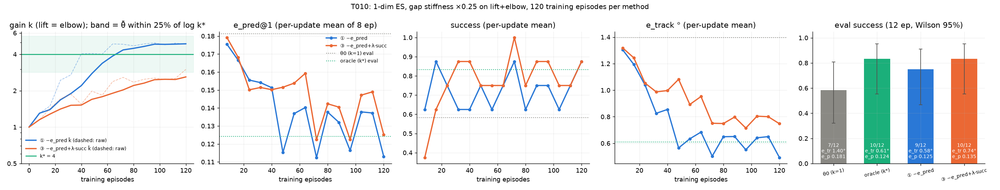

# T010: RL rehearsal in sim, stage A2 (H2-P1): 1-dim lift+elbow gain, real-robot settings

Branch `exp/wam-rl-sim-a2` (from `wam-control-gap` a53f10b). Outputs are in `/outputs/so101-playground/runs/T010/`:
- `queue/done/*.json`: one result per episode;
- `episodes/*.npz`: per-tick cmd/sent/q;
- `es/<method>.jsonl`: one line per ES update; `es/<method>.final.json`: θ̄, last iterate, all iterates;
- `server/`, `logs/`, `analysis.md`, `summary.json`, `gpu_time.log`.

Rows in `/outputs/so101-playground/results.tsv`: `T010-{epred,mixed}-{train,eval}`, `T010-baseline-theta0`,
`T010-oracle`. Figure `docs/T010_rl_sim_a2.png`. Code: `src/so101_playground/t010_es.py` (coordinator),
`t010_analysis.py`, gap `gainlh` in `control_gap.py`. The Isaac worker is T009's `scripts/t009_worker.py`, unchanged,
started with `--condition gainlh`.

## Question

T009 found three problems:
- its gap was too mild (θ0 11/12 success);
- a 5-dim ES did not converge in 64 episodes (per-pair SNR ≈ 1);
- the reported adapter was a noisy last iterate.

T010 re-runs the rehearsal with the settings intended for the real robot (stage C) and asks:
- with a gap that actually breaks the task and a 1-dim adapter, does ① (R = −e_pred only) recover success and
  tracking within the real-robot budget of 120 episodes?
- how does ③ (R = −e_pred + λ·success) compare at the same budget?

## Design

**Gap** (`gainlh`, fixed, unknown to the learner). This mirrors lowering the Feetech P gain on lift and elbow in
stage C:
- arm PD stiffness ×0.25 on shoulder_lift (Pitch 30 → 7.5) and elbow_flex (Elbow 25 → 6.25);
- all other joints, damping and Jaw nominal;
- oracle k* = 4 on both joints, log k* = 1.386.

**Pre-check (gate).** θ0 (k = 1) and the oracle (k = 4), each on the 6 home bin layouts × 2 jittered repeats. The
gate needs θ0 ≤ 7/12 and oracle ≥ 10/12. These 24 episodes are also the θ0/oracle eval.

**Adapter.** One shared gain k for shoulder_lift and elbow_flex:
- sent = q + k(cmd − q) on those two joints only, after the client's 15°/tick clamp and before the gap (as T009);
- pan, wrist_flex, wrist_roll and Jaw stay at k = 1;
- θ = log k, θ₀ = 0, k clipped to [0.5, 6]. `gain_adapter.K_MAX` was raised 4 → 6; T009's coordinator clips to 4
  itself, so T009 is unaffected.

**ES** (`t010_es.py`), identical for ① and ③ except the reward and the ε stream:
- Pair p runs home bin row p mod 6 with episode id 1000 + p. Each member gets its own ±1 cm / ±5° placement jitter.
  The layout order, episode ids and jitter draws depend only on p, so both methods share them.
- εₚ ~ N(0, 1) comes from a **per-method** stream, so the two methods' ε are independent (T009 shared one ε stream
  across methods). Members are θ ± σεₚ with **σ = 0.3**.
- dₚ = R(+) − R(−). **4 pairs per update:**
  - scale = RMS of all d so far in the run;
  - sₚ = clip(dₚ/scale, ±3);
  - g = mean(sₚεₚ);
  - θ ← clip(θ + ηg).
- **Step size η = 0.25.** With a consistent full-SNR gradient (dₚ ∝ εₚ), sₚ = εₚ/rms(ε), so E[g] = E[ε²]/√E[ε²] = 1
  and θ moves by ~0.25 per update. With pure noise, E[g] = 0 and sd(g) ≈ 0.5, a ±0.125 random walk per update.
  Reaching log k* = 1.39 from 0 at full SNR therefore takes ~6 updates (48 episodes).
- **Reported adapter: θ̄ = mean of the last 5 post-update iterates.** The raw iterate is logged too.
- 60 pairs = **120 episodes = 15 updates per method**.

**Rewards** (both computable on a real robot):
- ① R = −mean e_pred@1 (InternW0-Δ latent-1 prediction error, ticks 4–16 after each query, as T009);
- ③ R = −e_pred + λ·success, with **λ = 0.025**: a success flip is worth 2× T009's median paired |Δe_pred| (0.0125).

**Eval** (no exploration noise). θ̄ of ① and ③ on the 6 home bin layouts × 2 jittered repeats. The jitter and
episode id of each (row, repeat) are the same for every θ, so deltas vs θ0 are paired. CIs are 95% bootstrap over
episodes; success intervals are Wilson.

## Results



All 288 planned episodes ran: 24 pre-check, 2 × 120 training, 2 × 12 eval. No worker crashed and no job was
requeued.

### Pre-check: the gate passed at ×0.25 (no fallback needed)

θ0 7/12 (gate ≤ 7) and oracle 10/12 (gate ≥ 10). Both sit exactly on their thresholds, so ×0.2 was not tried.
Unlike T009 (θ0 11/12), this gap costs success: the black remote, the red pen and one purple toothbrush time out
at θ0, and all three succeed at the oracle.

### Eval (home bin 6 layouts × 2 jittered repeats)

| θ | k (lift = elbow) | success (Wilson 95%) | e_track ° | e_pred@1 | Δe_pred vs θ0 (paired) | Δsuccess vs θ0 | arm path ° | ticks |
|---|---|---|---|---|---|---|---|---|
| θ0 (gap, no adapter) | 1.00 | 7/12, 0.58 [0.32, 0.81] | 1.40 [1.33, 1.46] | 0.181 [0.165, 0.199] | — | — | 1271 | 706 |
| oracle | 4.00 | 10/12, 0.83 [0.55, 0.95] | 0.61 [0.52, 0.74] | 0.124 [0.110, 0.142] | **−0.057** [−0.082, −0.028] | +0.25 [−0.17, +0.67] | 1222 | 610 |
| ① −e_pred, θ̄ | 4.88 | 9/12, 0.75 [0.47, 0.91] | **0.58** [0.48, 0.71] | 0.125 [0.112, 0.143] | **−0.056** [−0.080, −0.027] | +0.17 [−0.25, +0.58] | 1268 | 617 |
| ③ −e_pred + λ·succ, θ̄ | 2.60 | 10/12, 0.83 [0.55, 0.95] | 0.74 [0.67, 0.84] | 0.135 [0.119, 0.155] | **−0.046** [−0.070, −0.014] | +0.25 [−0.17, +0.67] | 1051 | 535 |

Per object (S = success, T = 30 s timeout; repeat 0, repeat 1). The other failure kind never occurred.

| layout | θ0 | oracle | ① | ③ | training success ① / ③ (20 ep each) |
|---|---|---|---|---|---|
| black pen | SS | TT | TT | TT | 0.20 / 0.60 |
| black remote | TT | SS | SS | SS | 0.85 / 0.85 |
| blue paintbrush | SS | SS | SS | SS | 1.00 / 0.90 |
| red pen | TT | SS | TS | SS | 0.35 / 0.45 |
| purple toothbrush | TS | SS | SS | SS | 1.00 / 0.90 |
| razor | SS | SS | SS | SS | 0.95 / 0.95 |

**Pens separately:**
- θ0: pens 2/4, the other four objects 5/8;
- oracle: pens 2/4, others 8/8;
- ①: pens 1/4, others 8/8;
- ③: pens 2/4, others 8/8.

**On the four non-pen objects, both learned adapters recover the oracle exactly (8/8 vs θ0 5/8).** All remaining
failures are pens. The black pen fails at every stiff setting (oracle, ①, ③) and succeeds only at θ0, the same
"stiffer arm vs pen" effect as T009. With 12 episodes, no success difference clears zero.

### Learning (120 training episodes each)

| method | final θ̄ (k̄) | last iterate (k) | \|θ̄ − log k*\| | θ̄ first within 25% of log k* | raw iterate first within 25% | success flips | median \|paired Δe_pred\| | d e_pred / d log k (pooled OLS) | per-pair SNR |
|---|---|---|---|---|---|---|---|---|---|
| ① −e_pred | 1.586 (**4.88**) | 1.578 (4.84) | 0.199 | **update 6 = 56 episodes** | update 4 (40 ep) | 11/60 | 0.0065 | −0.034 [−0.046, −0.018] | 0.98 |
| ③ −e_pred + λ·succ | 0.955 (**2.60**) | 1.098 (3.00) | 0.432 | **never** (120 ep) | update 14 (120 ep) | 19/60 | 0.0175 | −0.026 [−0.045, −0.004] | 0.47 |

"Within 25%" means |θ̄ − 1.386| ≤ 0.347, i.e. k̄ ∈ [2.95, 5.42].

Training metrics, first 24 → last 24 episodes:

| method | success | e_track ° | e_pred |
|---|---|---|---|
| ① | 0.75 → 0.75 | 1.18 → 0.59 | 0.166 → 0.129 |
| ③ | 0.58 → 0.79 | 1.21 → 0.78 | 0.166 → 0.140 |

k / k̄ per update (training episodes: raw / mean of last 5):
- ①: 8: 1.30/1.30, 16: 1.49/1.39, 24: 2.44/1.68, 32: 2.70/1.89, 40: 4.04/2.20, 48: 4.06/2.76, 56: 4.01/3.37,
  64: 4.87/3.87, 72: 4.84/4.35, 80: 4.70/4.48, 88: 4.87/4.64, 96: 4.96/4.85, 104: 4.79/4.83, 112: 4.94/4.85,
  120: 4.84/4.88
- ③: 8: 1.15/1.15, 16: 1.42/1.28, 24: 1.71/1.41, 32: 1.88/1.51, 40: 1.55/1.52, 48: 1.98/1.69, 56: 1.84/1.78,
  64: 2.38/1.91, 72: 2.58/2.03, 80: 2.35/2.21, 88: 2.48/2.31, 96: 2.54/2.46, 104: 2.47/2.48, 112: 2.53/2.47,
  120: 3.00/2.60

**① converges in 1 dimension within the budget:**
- the raw iterate reaches k ≈ 4 at 40 episodes;
- θ̄ is within 25% of log k* from 56 episodes on;
- from 64 episodes on, the iterate stays in k 4.7–5.0 (steps of ±0.15 in k), so averaging is no longer needed;
- training e_track halves (1.18 → 0.59°, the oracle's 0.61°).

The per-pair SNR is still ≈ 1, as in T009. The fix was reducing the problem to 1 dimension, with a larger σ and
4 pairs per update, not a cleaner signal.

**① settles above k* (4.88 vs 4), and that is where e_pred puts its minimum.** I fitted e_pred against θ over all
288 episodes: a quadratic with one effect per layout row. Its minimum is at k ≈ 5.6 [4.3, 11] (bootstrap).

Binned e_pred:

| k | n | e_pred |
|---|---|---|
| < 1.5 | 59 | 0.176 |
| 1.5–2.5 | 75 | 0.145 |
| 2.5–3.5 | 54 | 0.130 |
| 3.5–4.5 | 47 | 0.133 |
| 4.5–6 | 53 | 0.125 |

e_pred is flat from k ≈ 3 to 6, which is why ①'s late paired differences are small (median 0.0065). Over-correcting
to 4.9 costs nothing in sim: e_track is 0.58° vs the oracle's 0.61°, and e_pred is the same. **On the real robot, a
gain about 20% above k* is a mild risk. Cap k at ~5.**

**③ was slower:** k̄ 2.60 at 120 episodes, never within 25%. Two causes, which this run cannot fully separate:
- **The success term adds noise to the reward.** ③ had 19 success flips in 60 pairs, against 11 for ①. Each flip
  is worth ±0.025, about 2× a typical e_pred difference. They inflate the RMS scale used to normalise d, so pure
  e_pred pairs get smaller steps. ③'s per-pair SNR is 0.47 against ①'s 0.98. Most flips pointed the same way as
  e_pred (15 agree, 4 disagree), so the success term was not wrong, just noisy.
- **The ε stream is independent and shorter steps compound.** I replayed ③'s own 60 pairs with an e_pred-only
  reward. The summed update would have been 5.36 instead of the actual 4.39, about 22% larger. That explains part
  of the gap to ①, not all of it. The rest is ③'s independent ε draws and a trajectory that stayed longer at low k,
  where success flips are frequent: training success was 0.58 at the start for ③ vs 0.75 for ①.

With one run per method, "③ is slower" is a single-seed observation. ③ is clearly not faster.

**Success as the learning signal.** Training success rose for ③ (0.58 → 0.79) but stayed flat for ① (0.75 → 0.75).
①'s per-batch mean jumps between 0.62 and 0.88 because the batch composition cycles through the pen rows (8
episodes per update over 6 rows), and ① settled at the stiffest gain, where the black pen fails (training 0.20).

**Hacking:**
- ① and ③ keep arm path length (1268° and 1051° vs θ0 1271°);
- both improve e_pred and e_track together, in the oracle's direction;
- neither loses success vs θ0.

③'s shorter path and fewer ticks come from more and faster successes, not a slower arm. No sign of hacking.

## Read

With a gap that breaks the task (θ0 7/12) and a 1-dim shared lift+elbow gain, **① (−e_pred only) recovers tracking
and success within the 120-episode budget**:
- k̄ 4.88 vs k* 4, within 25% of log k* by 56 episodes and stable from 64;
- eval e_track 0.58° (oracle 0.61°, θ0 1.40°);
- e_pred −0.056 vs θ0 (oracle −0.057);
- success 9/12 (oracle 10/12, θ0 7/12);
- the non-pen objects go 5/8 → 8/8, the same as the oracle.

Its remaining failures are the pens, which also fail at the oracle. **③ (λ = 0.025) is not better.** It reaches the
same success on 12 eval episodes (10/12), but its k̄ is only 2.60, e_track is worse (0.74°), and it never got within
25% of log k*. The success term mostly added reward noise: per-pair SNR 0.47 vs 0.98.

**Concrete settings for real stage C** (lower the Feetech P gain on lift + elbow):

| setting | value |
|---|---|
| reward | −e_pred only. Log success, but do not add it to the reward. If a guard is wanted, use success as a stop/rollback check rather than a reward term. If λ is kept, use ≤ 0.01 (well under the typical paired \|Δe_pred\|). |
| θ | 1-dim: log of a shared gain on the joints whose P gain was lowered. Others fixed at k = 1. Clip k to [0.5, 5]. |
| σ | 0.3 in log-k |
| pairs per update | 4 antithetic pairs, same layout per pair, independent re-placement |
| step | η = 0.25, with d normalised by the running RMS and s clipped at ±3 (≈ 0.25 per update at full SNR) |
| episodes | 120 (60 pairs, 15 updates). Expect convergence by ~60 episodes; the second half confirms stability and gives θ̄. |
| report | θ̄ = mean of the last 5 iterates |
| eval | ≥ 12 episodes per θ with pens counted separately. Success on 12 episodes cannot separate the oracle from θ0 (CIs overlap); use e_track/e_pred as the primary evidence. |

If the real gap is milder than k* = 4, expect proportionally fewer updates. If e_pred's flat region extends past
the clip, ① will sit at the clip. That is harmless in sim but should be watched on hardware.

## Compute

GPU 0 ran the InternW0 server (`--seed_per_query`, port 18991). GPU 1 ran 2 Isaac clients next to another
project's 10 GB.

Window 2026-11-23 21:29:52 → 2026-11-24 04:22:20 (`runs/T010/gpu_time.log`): 6.87 h × 2 cards = **13.7 GPU-h**,
under the 18 GPU-h cap. Throughput was 32 ep/h during the pre-check, rising to ~44 ep/h as more episodes succeeded
(a timeout is 900 ticks, ≈ 280 s; a success is ≈ 450–600 ticks).

The Isaac venv named in the brief (`wam-control-gap/envs/isaac`) has no `.venv`. The workers used
`scaffold-env/envs/isaac`, the script default, as in T009.

## Reproduce

```bash
R=/outputs/so101-playground/runs/T010
PY=/workspace/so101-playground/.claude/worktrees/wam-control-gap/envs/flux3/flux-action/.venv/bin/python
IW_ENV=/workspace/so101-playground/.claude/worktrees/wam-internw0/envs/internw0 GPU=0 \
    scripts/run_internw0_server.sh 18991 $R/server --seed_per_query &
GPU=1 scripts/run_t009_worker.sh 18991 $R w1 --condition gainlh &
GPU=1 scripts/run_t009_worker.sh 18991 $R w2 --condition gainlh &
cd src
$PY -m so101_playground.t010_es eval --tag T010-baseline-theta0 --theta 0 --root $R     # pre-check / eval
$PY -m so101_playground.t010_es eval --tag T010-oracle --theta oracle --root $R
for m in epred mixed; do $PY -m so101_playground.t010_es train --method $m --root $R & done  # + eval of θ̄
# when all jobs are done: touch $R/queue/STOP (workers exit), stop the server
$PY -m so101_playground.t010_analysis --root $R --plot ../docs/T010_rl_sim_a2.png --tsv /outputs/so101-playground/results.tsv
```

The coordinators are restartable. They rebuild θ from `queue/done/` and never resubmit a pending, running or done
job. The results.tsv CIs are a separate bootstrap draw from `analysis.md` and can differ in the third decimal. The
doc quotes `analysis.md`.
