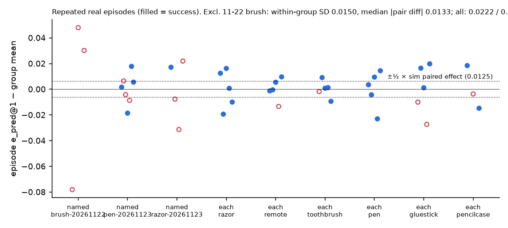

# T011: real-robot e_pred of InternW0-Δ (stage B diagnosis)

Branch `exp/real-epred` (from `exp/real-internw0-server` 920f5eb). Code: `src/so101_playground/t011_real_epred.py`
(VAE encode / codec / decode, envs/internw0), `t011_analysis.py` (tables, figures, results.tsv),
`t011_visual.py` (decoded frames and clips), `t011_sheets.py` (contact sheets for labels).
Outputs: `/outputs/so101-playground/runs/T011/` (`episodes.csv` per episode, `queries.jsonl` per query,
`summary.json`, `alignment.json`, `codec_motion.jsonl`, `sheets/`, `decoded/`, `clips/`, `fig_*.png`).
results.tsv rows `T011-real-{all,named,each,<object>}`. No training. The VAE ran on GPU 1 (about 2 GB, bf16).

Data: 45 home episodes (6 on 2026-11-22, 39 on 2026-11-23) and the T008 server logs `run_1122_2342` and
`run_1123_2311` (1479 queries). Sim reference, all at θ0 on the 6 home-bin layouts:
- T007 Phase A `none`: 6 episodes;
- T007 Phase B `none`: 6 episodes;
- T009 `baseline-theta0` and `theta0-nojit`: 16 episodes.

Together these give 28 sim episodes and 954 queries.

## 1. Alignment and sanity

| check | result |
|---|---|
| home ↔ server episodes | 45 ↔ 45, 1:1. Home clock = UTC+9; residual 0 s on every episode. No duplicates; no unmatched server episodes. |
| queries | `policy_query` count = server query count in all 45 episodes (1479). `q` is contiguous and `restarted` at q = 0. Instructions are identical. |
| mp4 | frame count = `steps` for both cameras in all episodes |
| state | server `state` = npz `state`, max diff 0.0° |
| query frame | The PNG is closest to mp4 frame `s` in 100% of queries. Mean \|Δpixel\| is 2.19 at `s`, 3.96 at `s−1` and 6.74 at `s+1`. |
| **L0 re-encode** | **MSE 0.0 (bit-exact)**, after one fix, below |
| **mp4 codec floor** (L0: PNG vs mp4 of the same frame) | **e_codec = 0.0073** (median 0.0073, p90 0.0105). Overhead 0.0055, wrist 0.0091. That is 3% of real e_pred@1. |
| codec under motion | Proxy: re-compress the mp4 once more (mpeg4, same bitrate; 10 episodes, 257 queries). The second-generation L1 error rises only from 0.0010 (static) to 0.0016 (20–40° motion). The second-generation L0 error is 0.0020, against 0.0072 for the first generation (×3.6). Scaled by 3.6, the codec part of e_pred@1 is ≤ 0.006 at any motion. |
| PNG vs mp4 as clip frame 0 | e_pred@1 changes by −0.004 (`e_pred@1_mp4`) |

**Recipe fix.** The server's session `video_layout` is empty. So `encode_video_latents` takes the plain path and
encodes the whole 384×256 two-camera canvas in **one VAE pass**. It does not encode each camera slot separately,
although the config says `concat_multi_camera: vertical` and the probe-server docstring implies per-slot.
- A per-slot encode reproduces the logged L0 only to MSE 0.010. That is larger than the codec floor.
- The plain pass gives 0.0 in bf16 (9e-5 in fp32).

The same server code produced the T006/T007/T009 numbers, so sim and real use the same encoding. Matching it
needs only the VAE (`VAE` in `t011_real_epred.py`); the 17 GB model is not loaded.

**Arm hold during queries.** The runner blocks for each query: median hold **0.80 s (24 ticks)**, p10–p90
0.76–0.85 s, max 8.6 s; server compute is 0.58 s (median). In sim the physics pauses during a query, so the arm
freezes with its velocity kept. On the real arm the servos keep tracking the last goal through the 0.8 s and
settle. Every real chunk therefore starts from rest (stop-and-go).

## 2. Real e_pred

| | real (45 ep, 1433 q) | sim θ0 home bin (28 ep, 954 q) |
|---|---|---|
| e_pred@1 (query mean) | **0.233** | **0.148** (T007A 0.134, T007B 0.136, T009 0.159) |
| e_pred@1 episode mean | 0.236 | 0.145 |
| e_pred@1 overhead / wrist | 0.100 / 0.365 | 0.040 / 0.257 |
| e_pred@2 | 0.335 | 0.198 (T007 only) |
| e_static@1 | 0.375 | 0.382 |
| e_track (\|cmd(t−1) − q(t)\|, arm, °) | 1.60 (2.21 while moving) | 0.98 (per query; T009 θ0 episode 1.22) |

By object, episode-mean e_pred@1 (real n; sim layout):

| object | real n | real success | real e_pred@1 | sim e_pred@1 (layout) | excess |
|---|---|---|---|---|---|
| pen | 13 | 0.77 | 0.246 | 0.155 (black + red pen) | +0.090 |
| razor | 10 | 0.70 | 0.232 | 0.136 | +0.097 |
| remote | 6 | 0.67 | 0.237 | 0.159 | +0.075 |
| toothbrush | 5 | 0.80 | 0.216 | 0.141 | +0.072 |
| brush (makeup; sim: paintbrush) | 3 | 0.00 | 0.233 | 0.138 | +0.087 |
| glue stick (real only) | 5 | 0.60 | 0.217 | — | |
| pencil case (real only) | 3 | 0.67 | 0.268 | — | |

Every object is about +0.07 to +0.10 above sim. The excess does not depend on the object.


## 3. Success labels (visual, no human labels)

Labelled from the first, last−60 and last overhead frames (`runs/T011/sheets/sheet_*.jpg`,
`sheets/uncertain_last.jpg`). All `end_reason` = `docked`, so `end_reason` carries no outcome. Full table:
`episodes.csv` (columns `success`, `confidence`, `note`); the labels live in `LABELS` in `t011_analysis.py`.

| # | episode | target | label | conf | note |
|---|---|---|---|---|---|
| 0 | 1122_235102 named pen | pen | S | high | black pen in bin. Table: black pen, red pen, remote, razor (11-22 clear bin). |
| 1 | 1122_235228 named remote | remote | F | high | wrong object: razor placed |
| 2–4 | 1122_2353–2355 named brush ×3 | makeup brush | F F F | high | Bin empty. In #3 a human rearranges objects mid-episode. |
| 5 | 1122_235639 named razor | razor | S | high | |
| 6–12 | 1123_2324–2329 named pen ×7 | pen | S F F S F S S | high | #7 places the toothbrush; #8 and #10 leave the bin empty. Table: pen, toothbrush, remote, razor (opaque bin from 11-23). |
| 13–16 | 1123_2330–2332 named razor ×4 | razor | S F F F | high | #14–16 all place the toothbrush |
| 17–21 | each, razor only | razor | S ×5 | high | |
| 22–26 | each, remote only | remote | S S S F S | high | #25: remote left standing on its end beside the bin (1600 steps) |
| 27–31 | each, toothbrush only | toothbrush | F S S S S | high | #27: untouched |
| 32–36 | each, pen only (various pens) | pen | S ×5 | high | |
| 37–41 | each, glue stick only | glue stick | F S S F S | high | #37 and #40: untouched; arm ends extended |
| 42–44 | each, pencil case only | pencil case | S? F? S? | med / low / med | see below |

Totals: 30 S / 15 F (named 7/17, each 23/28). Each "place each object" episode had **one** object on the table
(first frames): razor 5, remote 5, toothbrush 5, pen 5, glue stick 5, pencil case 3.

**For the human to confirm:**
- **#43** (`20261123_235747`): the pencil case rests across the bin rim, about half inside. Labelled F (low).
- **#42** (`235705`): the case stands in the bin, its top above the rim. Labelled S (medium).
- **#44** (`235957`): the case is inside, but the bin was pushed and tilted. Labelled S (medium).
- #3 (`20261122_235457`): a human hand rearranges objects mid-episode. Keep it, or exclude it?
- #0: "the pen" with two pens on the table; the black one was placed. Labelled S.
- #1, #7, #14–16: wrong object placed. Labelled F.

## 4. Real vs sim: visual offset or control gap?

1. **Offset at a static arm (visual gap).** With motion over the next 16 ticks < 2° (305 real and 212 sim
   queries), e_pred@1 is real 0.176 vs sim 0.139 (**+0.037**). An OLS on motion gives intercepts
   0.181 [0.175, 0.188] and 0.145 [0.139, 0.151]. The overhead region alone is 0.072 vs 0.033 when static.
   First queries (q = 0) are not static: the arm leaves home at about 23°, giving 0.319 vs 0.163.
2. **Growth with motion (control gap).** The real slope is **0.0033 /°** [0.0030, 0.0036]; the sim slope is
   0.00044 /° [0.00015, 0.00073], about 7× smaller. At 20–40° motion: real 0.282, sim 0.161 (+0.12).
   - Both cameras grow (overhead 0.072 → 0.125, wrist 0.280 → 0.440).
   - The codec explains ≤ 0.006 of this (§1).
3. **Tracking error absorbs the motion effect.** Real: e_pred@1 = 0.165 + 0.044·e_track16 (R² 0.29). Adding motion
   leaves a motion coefficient of 0.0003. Sim: 0.130 + 0.022·e_track16 (R² 0.06). At matched motion, the real arm
   tracks worse while moving and slightly better while static:

   | motion | real e_track16 | sim e_track16 |
   |---|---|---|
   | 0–2° | 0.47° | 0.59° |
   | 10–20° | 1.61° | 1.05° |
   | 20–40° | 2.61° | 1.31° |

   Decomposition of the +0.081 mean excess:

   | component | size |
   |---|---|
   | intercept (visual) | **+0.034** |
   | more real tracking error × real slope | **+0.025** |
   | steeper slope × sim tracking | **+0.021** |

   So about 40% is a constant visual offset and about 60% grows with motion and tracking error. The tracking-linked
   part fits the stop-and-go hold (chunks start from rest and lag) plus the real servo response. It is what an RL
   reward on control would act on.
4. **Decoded predictions** (`T011_decoded.jpg`, `runs/T011/clips/*.mp4`; real | predicted L0+d1 | VAE recon).
   - The VAE recon of the real clip is sharp. The error is in the prediction, not in the VAE or the codec.
   - Overhead: the predicted arm is a smeared, checkered ghost near the right pose; the static scene is right.
   - Wrist: the prediction is a heavy blur. Object edges become dark smudges, and the real background
     (wall / door, the 11-23 bin) is not reproduced.
   - The wrist is the larger term in both domains (real 0.365, sim 0.257).


## 5. RL usability

**Noise floor (same object, same instruction, θ0).** Nine groups of ≥ 3 repeats, 83 episode pairs:

| set | median \|pair diff\| | within-group SD |
|---|---|---|
| all groups | 0.0142 | 0.0222 |
| excluding the 11-22 brush trio (#3 has a human in the scene) | **0.0133** | **0.0150** |
| same, successes only | 0.0120 | |
| same, motion-adjusted (per-query e_pred − 0.0033·motion) | 0.0121 | 0.0133 |
| sim jitter noise at θ0 (T009) | 0.0076 | |
| sim expected paired effect (T009) | **0.0125** | |

Real repeat noise is about 1.8× the sim jitter noise and equals the sim paired effect. One real episode pair
therefore has SNR ≈ 1, against ≈ 1.6 in sim.

Partly offsetting this, real e_pred is about 2× more sensitive to tracking error (0.044 vs 0.022 per °), and the
real arm has about 1.3° more tracking error to remove while moving. A gain change that cut real e_track by 1° would
be worth about 0.04 in e_pred, roughly 3× the noise floor. That is an extrapolation from the cross-sectional slope,
not a measured paired effect.

**Success vs failure.** There is no signal: pooled AUROC (failures higher) is 0.48. Within groups, failures are
slightly **lower** (group-centred AUROC 0.24, every within-group difference ≤ 0). Most real failures are
wrong-object or never-grasped episodes. The model predicts the motion the arm then makes, so e_pred does not see task
failure. As in sim, e_pred is a dynamics-consistency signal, not a task reward.

**Tracking error.** Per query, Spearman ρ(e_pred@1, e_track16) is 0.61 real (0.59 within episode) and 0.33 sim.
The partial ρ given motion is 0.22 real and 0.34 sim. Per episode it is 0.34 real.



## Read

Real e_pred is usable as a control-gap reward, but not as the only reward and not at the T009 batch size.
- **It is clean and correctly measured.** Alignment is exact and L0 is bit-exact. The codec floor (0.007) is small.
- **The visual offset is constant.** The +0.034 intercept is the same for every object and is present with a
  static arm. Paired comparisons cancel it, so it does not stop RL.
- **It tracks control better than in sim.** The rest of the excess grows with real tracking error, and per query
  e_pred tracks e_track more strongly than in sim (R² 0.29 vs 0.06).
- **Noise is the problem.** Same-θ repeat noise (median |Δ| 0.013) equals the sim paired effect (0.0125). It is
  blind to task success, so a success term (or success constraint) is still needed, as T009's hacking flags showed.

Before stage C:
1. Use about 3–4× more episode pairs per update than T009, or compare at the query level with object/motion
   covariates (the motion adjustment cuts the noise SD 0.015 → 0.013).
2. Hold the scene fixed per pair: same object, same pose, no human in frame.
3. Keep the 0.8 s query hold identical across arms, or shorten it: it is part of the control gap being rewarded.
4. Get human success labels for #42–44 (and confirm the wrong-object failures) before success enters the reward.
5. Note the encode is the plain whole-canvas pass (§1) when reusing the server outside this pipeline.

## Reproduce

```bash
IW=/workspace/so101-playground/.claude/worktrees/wam-internw0/envs/internw0/InternW0-Delta/.venv/bin/python
cd src
CUDA_VISIBLE_DEVICES=1 PYTORCH_CUDA_ALLOC_CONF=expandable_segments:True $IW -m so101_playground.t011_real_epred encode   # ~10 min
CUDA_VISIBLE_DEVICES=1 $IW -m so101_playground.t011_real_epred codec --tmp $TMPDIR --episodes <10 dirs in summary.json codec_motion>
CUDA_VISIBLE_DEVICES=1 $IW -m so101_playground.t011_real_epred decode --episodes 20261123_232455_... 20261123_232546_... 20261123_233440_... 20261123_234054_...
$IW -m so101_playground.t011_sheets
# analysis / figures need numpy + matplotlib (not in envs/internw0): any env with both
python -m so101_playground.t011_analysis --tsv /outputs/so101-playground/results.tsv
python -m so101_playground.t011_visual
```
