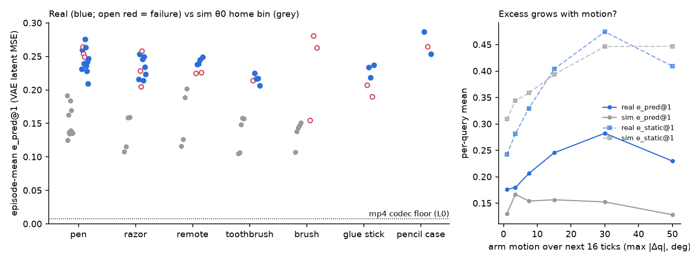
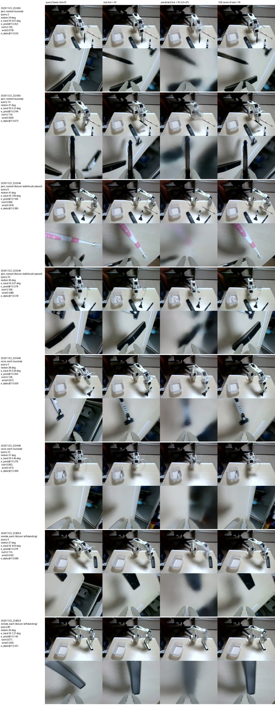
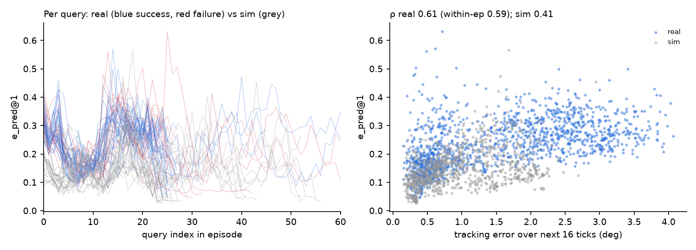
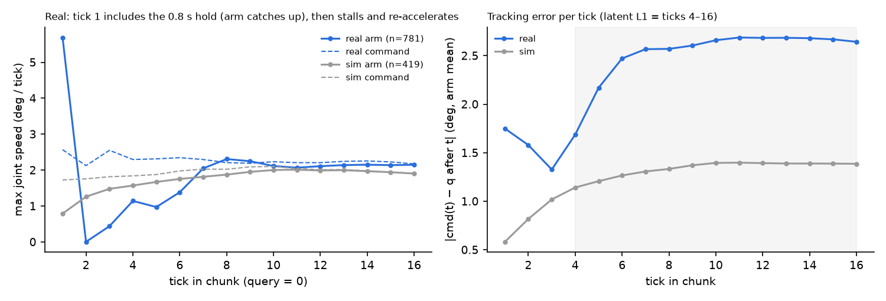

# T011: real-robot e_pred of InternW0-Δ (stage B diagnosis)

Branch `exp/real-epred` (from `exp/real-internw0-server` 920f5eb). Code: `src/so101_playground/t011_real_epred.py`
(VAE encode / codec / decode, envs/internw0), `t011_analysis.py` (tables, figures, results.tsv),
`t011_visual.py` (decoded frames and clips), `t011_sheets.py` (contact sheets for labels).
Outputs: `/outputs/so101-playground/runs/T011/` (`episodes.csv` per episode, `queries.jsonl` per query,
`summary.json`, `alignment.json`, `codec_motion.jsonl`, `sheets/`, `decoded/`, `clips/`, `fig_*.png`).
results.tsv rows `T011-real-{all,named,each,<object>}`. No training. The VAE ran on GPU 1 (about 2 GB, bf16).

Data: 45 home episodes (6 on 2026-11-22, 39 on 2026-11-23) and the T008 server logs `run_1122_2342` and
`run_1123_2311` (1479 queries). Sim reference, all at θ0 on the 6 home-bin layouts:
- T007 Phase A `none`: 6 episodes;
- T007 Phase B `none`: 6 episodes;
- T009 `baseline-theta0` and `theta0-nojit`: 16 episodes.

Together these give 28 sim episodes and 954 queries.

## 1. Alignment and sanity

| check | result |
|---|---|
| home ↔ server episodes | 45 ↔ 45, 1:1. Home clock = UTC+9; residual 0 s on every episode. No duplicates; no unmatched server episodes. |
| queries | `policy_query` count = server query count in all 45 episodes (1479). `q` is contiguous and `restarted` at q = 0. Instructions are identical. |
| mp4 | frame count = `steps` for both cameras in all episodes |
| state | server `state` = npz `state`, max diff 0.0° |
| query frame | The PNG is closest to mp4 frame `s` in 100% of queries. Mean \|Δpixel\| is 2.19 at `s`, 3.96 at `s−1` and 6.74 at `s+1`. |
| **L0 re-encode** | **MSE 0.0 (bit-exact)**, after one fix, below |
| **mp4 codec floor** (L0: PNG vs mp4 of the same frame) | **e_codec = 0.0073** (median 0.0073, p90 0.0105). Overhead 0.0055, wrist 0.0091. That is 3% of real e_pred@1. |
| codec under motion | Proxy: re-compress the mp4 once more (mpeg4, same bitrate; 10 episodes, 257 queries). The second-generation L1 error rises only from 0.0010 (static) to 0.0016 (20–40° motion). The second-generation L0 error is 0.0020, against 0.0072 for the first generation (×3.6). Scaled by 3.6, the codec part of e_pred@1 is ≤ 0.006 at any motion. |
| PNG vs mp4 as clip frame 0 | e_pred@1 changes by −0.004 (`e_pred@1_mp4`) |

**Recipe fix.** The server's session `video_layout` is empty. So `encode_video_latents` takes the plain path and
encodes the whole 384×256 two-camera canvas in **one VAE pass**. It does not encode each camera slot separately,
although the config says `concat_multi_camera: vertical` and the probe-server docstring implies per-slot.
- A per-slot encode reproduces the logged L0 only to MSE 0.010. That is larger than the codec floor.
- The plain pass gives 0.0 in bf16 (9e-5 in fp32).

The same server code produced the T006/T007/T009 numbers, so sim and real use the same encoding. Matching it
needs only the VAE (`VAE` in `t011_real_epred.py`); the 17 GB model is not loaded.

**Arm hold during queries.** The runner blocks for each query: median hold **0.80 s (24 ticks)**, p10–p90
0.76–0.85 s, max 8.6 s; server compute is 0.58 s (median). In sim the physics pauses during a query, so the arm
freezes with its velocity kept. On the real arm the servos keep tracking the last goal through the 0.8 s and
settle. Every real chunk therefore starts from rest (stop-and-go).

## 2. Real e_pred

| | real (45 ep, 1433 q) | sim θ0 home bin (28 ep, 954 q) |
|---|---|---|
| e_pred@1 (query mean) | **0.233** | **0.148** (T007A 0.134, T007B 0.136, T009 0.159) |
| e_pred@1 episode mean | 0.236 | 0.145 |
| e_pred@1 overhead / wrist | 0.100 / 0.365 | 0.040 / 0.257 |
| e_pred@2 | 0.335 | 0.198 (T007 only) |
| e_static@1 | 0.375 | 0.382 |
| e_track (\|command − state after it\|, arm, °) | 1.60 (2.21 while moving); per chunk 1.55 | per chunk 0.96 (T009 θ0 episode 1.22) |

By object, episode-mean e_pred@1 (real n; sim layout):

| object | real n | real success | real e_pred@1 | sim e_pred@1 (layout) | excess |
|---|---|---|---|---|---|
| pen | 13 | 0.77 | 0.246 | 0.155 (black + red pen) | +0.090 |
| razor | 10 | 0.70 | 0.232 | 0.136 | +0.097 |
| remote | 6 | 0.67 | 0.237 | 0.159 | +0.075 |
| toothbrush | 5 | 0.80 | 0.216 | 0.141 | +0.072 |
| brush (makeup; sim: paintbrush) | 3 | 0.00 | 0.233 | 0.138 | +0.087 |
| glue stick (real only) | 5 | 0.60 | 0.217 | — | |
| pencil case (real only) | 3 | 0.67 | 0.268 | — | |

Every object is about +0.07 to +0.10 above sim. The excess does not depend on the object.



## 3. Success labels (visual, no human labels)

Labelled from the first, last−60 and last overhead frames (`runs/T011/sheets/sheet_*.jpg`,
`sheets/uncertain_last.jpg`). All `end_reason` = `docked`, so `end_reason` carries no outcome. Full table:
`episodes.csv` (columns `success`, `confidence`, `note`); the labels live in `LABELS` in `t011_analysis.py`.

| # | episode | target | label | conf | note |
|---|---|---|---|---|---|
| 0 | 1122_235102 named pen | pen | S | high | black pen in bin. Table: black pen, red pen, remote, razor (11-22 clear bin). |
| 1 | 1122_235228 named remote | remote | F | high | wrong object: razor placed |
| 2–4 | 1122_2353–2355 named brush ×3 | makeup brush | F F F | high | Bin empty. In #3 a human rearranges objects mid-episode. |
| 5 | 1122_235639 named razor | razor | S | high | |
| 6–12 | 1123_2324–2329 named pen ×7 | pen | S F F S F S S | high | #7 places the toothbrush; #8 and #10 leave the bin empty. Table: pen, toothbrush, remote, razor (opaque bin from 11-23). |
| 13–16 | 1123_2330–2332 named razor ×4 | razor | S F F F | high | #14–16 all place the toothbrush |
| 17–21 | each, razor only | razor | S ×5 | high | |
| 22–26 | each, remote only | remote | S S S F S | high | #25: remote left standing on its end beside the bin (1600 steps) |
| 27–31 | each, toothbrush only | toothbrush | F S S S S | high | #27: untouched |
| 32–36 | each, pen only (various pens) | pen | S ×5 | high | |
| 37–41 | each, glue stick only | glue stick | F S S F S | high | #37 and #40: untouched; arm ends extended |
| 42–44 | each, pencil case only | pencil case | S? F? S? | med / low / med | see below |

Totals: 30 S / 15 F (named 7/17, each 23/28). Each "place each object" episode had **one** object on the table
(first frames): razor 5, remote 5, toothbrush 5, pen 5, glue stick 5, pencil case 3.

**For the human to confirm:**
- **#43** (`20261123_235747`): the pencil case rests across the bin rim, about half inside. Labelled F (low).
- **#42** (`235705`): the case stands in the bin, its top above the rim. Labelled S (medium).
- **#44** (`235957`): the case is inside, but the bin was pushed and tilted. Labelled S (medium).
- #3 (`20261122_235457`): a human hand rearranges objects mid-episode. Keep it, or exclude it?
- #0: "the pen" with two pens on the table; the black one was placed. Labelled S.
- #1, #7, #14–16: wrong object placed. Labelled F.

## 4. Real vs sim: visual offset or control gap?

**One tracking definition for both domains (review fix, 2026-11-24).** e_track16 is the mean over chunk ticks
k = 1..16 of |command issued at tick k − arm state after that command was applied for one tick|. Arm joints, °.
- Real: `command_sim_deg[s+k−1]` vs `state_sim_deg[s+k]`. The state is read at the start of a step, before that
  step's command.
- Sim: `cmd[i+k−1]` vs `q[i+k−1]`. `q` is logged after `env.step`.
- motion16 = max |state after tick 16 − state at the query| in both. Code: `chunk_profile` in `t011_analysis.py`.

The first version had two errors on the sim side, and both are fixed:
- **T009 episode logs start after the 45-tick hold, but were indexed by step.** Every T009 query read the arm 45
  ticks late. T007 logs start at step 0 and were right.
- **sim motion16 started one tick late.**

No real-side number changed. The sim slope and the excess decomposition did; the first version's numbers are in
brackets below.

1. **Offset at a static arm (visual gap).** With motion over the next 16 ticks < 2° (305 real and 211 sim
   queries), e_pred@1 is real 0.176 vs sim 0.130 (**+0.046**) [was 0.139, +0.037]. The overhead region alone is
   0.072 vs 0.031 when static. First queries (q = 0) are not static: the arm leaves home at about 23°, giving 0.319
   vs 0.163.
2. **Growth with motion.**
   - Slopes: real **0.0033 /°** [0.0030, 0.0036]; sim −0.0001 /° [−0.0004, 0.0001], i.e. flat [was 0.00044].
   - At 20–40° motion: real 0.282, sim 0.152 (+0.13).
   - Both real cameras grow (overhead 0.072 → 0.125, wrist 0.280 → 0.440).
   - The codec explains ≤ 0.006 of this (§1).
3. **Tracking error absorbs the motion effect, with the same slope in both domains.**

   | | fit | R² | first version |
   |---|---|---|---|
   | real | e_pred@1 = 0.165 + **0.044**·e_track16 | 0.29 | unchanged |
   | sim | e_pred@1 = 0.106 + **0.044**·e_track16, slope CI [0.037, 0.052] | 0.14 | 0.130 + 0.022·e_track16, R² 0.06 |

   Adding motion to the real fit leaves a motion coefficient of 0.0003. At matched motion, the real arm tracks
   worse while moving:

   | motion | real e_track16 | sim e_track16 |
   |---|---|---|
   | 0–2° | 0.47° | 0.54° |
   | 10–20° | 1.61° | 1.06° |
   | 20–40° | 2.61° | 1.33° |

   Decomposition of the +0.084 mean excess:

   | component | size | first version |
   |---|---|---|
   | intercept (visual) | **+0.058** | +0.034 |
   | more real tracking error × slope | **+0.026** | +0.025 |
   | slope difference × sim tracking | **−0.000** | +0.021 |

   About 70% is a constant visual offset and about 30% is the real arm's larger tracking error. The model
   responds to tracking error identically in real and sim. The real arm simply tracks worse while moving, and that
   is why the real excess grows with motion and the sim does not.

### 4b. Stop-and-restart at each query (L1 question)

Per-tick profiles for moving chunks (10–40° over the chunk; 781 real, 419 sim): `T011_restart.png`,
`summary.json` → `restart`.

- **Real speed.** Each real "tick 1" spans the 0.8 s hold. The state and frame sent to the server are read before
  the query, so the arm catches up with its lag during the hold: **5.7°** on the fastest joint.
  - Tick 2: **0.003 °/tick**, i.e. stopped.
  - Ticks 3–7: re-acceleration (0.4, 1.1, 1.0, 1.4, 2.0).
  - From tick 8: the commanded speed, about 2.2 °/tick.
- **Sim speed.** The arm never stops. Its speed ramps smoothly from 0.8 to 2.0 over ticks 1–9, behind a command
  that is already 1.7–2.1.
- **Tracking error per tick.**
  - Real: 1.75 → 1.33 (ticks 1–3; the hold catch-up resets it), then rises to a **plateau of about 2.65° from
    tick 6**.
  - Sim: 0.58 → plateau of about 1.39° from tick 9.

  At matched motion, the real − sim excess is **+0.49° in ticks 1–8 and +0.61° in ticks 9–16**. Over ticks 4–8
  (the frames at +4 and +8 inside latent L1) it is +0.52°.
- **Most of the real tracking excess is steady-state lag, not the restart.** Ticks 9–16 are past the
  re-acceleration, and there the real arm lags 1.23 ticks of motion against 0.71 in sim. That is servo response
  (gain, velocity limit), which a gain/feed-forward adapter can act on.
- **Share of the excess due to the stop-restart.** Real fit: e_pred@1 = 0.163 + 0.029·e_track(1–8) +
  0.017·e_track(9–16) (R² 0.29).
  - Lower estimate: give each real chunk sim's early/late tracking ratio at its motion and keep its late lag. The
    e_pred reduction is **0.006**, 8% of the +0.084 excess and 25% of the tracking-linked +0.026.
  - Upper bound: treat all of the early-tick excess (+0.49°) as restart. That gives **0.014**, 17% of the excess.
  - So the stop-restart explains about **0.006–0.014** of e_pred.
- **Sim test.** Among sim moving chunks, a slow start (low tick-1 speed) does not raise e_pred at matched motion:
  coefficient −0.002 [−0.011, 0.006]; ρ 0.03.
- **What is not measured here.** The hold itself also moves the arm by up to about 6° between the query frame and
  tick 1, which in sim never happens. It is part of the observed L1 change, but it is the catch-up of the arm's own
  lag, not new motion. Separating its effect on e_pred would need a run with a shorter hold, or with the state and
  frames re-read after the query.
- **For stage C.** A gain adapter can reduce the steady-state part (+0.026 − about 0.01). It cannot remove the hold,
  the stall or the visual offset (+0.058). The 0.006–0.014 restart part, and how the hold length interacts with any
  gain change, has to be held constant across compared θ: same hold, same runner.
4. **Decoded predictions** (`T011_decoded.jpg`, `runs/T011/clips/*.mp4`; real | predicted L0+d1 | VAE recon).
   - The VAE recon of the real clip is sharp. The error is in the prediction, not in the VAE or the codec.
   - Overhead: the predicted arm is a smeared, checkered ghost near the right pose; the static scene is right.
   - Wrist: the prediction is a heavy blur. Object edges become dark smudges, and the real background
     (wall / door, the 11-23 bin) is not reproduced.
   - The wrist is the larger term in both domains (real 0.365, sim 0.257).





## 5. RL usability

**Noise floor (same object, same instruction, θ0).** Nine groups of ≥ 3 repeats, 83 episode pairs:

| set | median \|pair diff\| | within-group SD |
|---|---|---|
| all groups | 0.0142 | 0.0222 |
| excluding the 11-22 brush trio (#3 has a human in the scene) | **0.0133** | **0.0150** |
| same, successes only | 0.0120 | |
| same, motion-adjusted (per-query e_pred − 0.0033·motion) | 0.0121 | 0.0133 |
| sim jitter noise at θ0 (T009) | 0.0076 | |
| sim expected paired effect (T009) | **0.0125** | |

Real repeat noise is about 1.8× the sim jitter noise and equals the sim paired effect. One real episode pair
therefore has SNR ≈ 1, against ≈ 1.6 in sim.

Partly offsetting this, the real arm has about 1.3° more tracking error to remove while moving. e_pred responds to
tracking error with the same slope as in sim (0.044 per °; the first version's "2× more sensitive" came from the
T009 misalignment). A gain change that cut real e_track by 1° would be worth about 0.04 in e_pred, roughly 3× the
noise floor. That is an extrapolation from the cross-sectional slope, not a measured paired effect.

**Success vs failure.** There is no signal: pooled AUROC (failures higher) is 0.48. Within groups, failures are
slightly **lower** (group-centred AUROC 0.24, every within-group difference ≤ 0). Most real failures are
wrong-object or never-grasped episodes. The model predicts the motion the arm then makes, so e_pred does not see task
failure. As in sim, e_pred is a dynamics-consistency signal, not a task reward.

**Tracking error.** Per query, Spearman ρ(e_pred@1, e_track16) is 0.61 real (0.59 within episode) and 0.41 sim
(0.27 within episode). The partial ρ given motion is 0.22 real and 0.41 sim. Per episode it is 0.34 real.


## Read

Real e_pred is usable as a control-gap reward, but not as the only reward and not at the T009 batch size.
- **It is clean and correctly measured.** Alignment is exact and L0 is bit-exact. The codec floor (0.007) is small.
- **The visual offset is constant.** The +0.058 intercept (about 70% of the excess) is the same for every object
  and is present with a static arm (+0.046). Paired comparisons cancel it, so it does not stop RL.
- **It responds to control as in sim.** The same slope applies, 0.044 per ° of tracking error. The rest of the
  excess (+0.026) is the real arm's larger tracking error, mostly steady-state servo lag. Of that, 0.006–0.014 is
  the stop-restart at each query, which an adapter cannot fix (§4b).
- **Noise is the problem.** Same-θ repeat noise (median |Δ| 0.013) equals the sim paired effect (0.0125). It is
  blind to task success, so a success term (or success constraint) is still needed, as T009's hacking flags showed.

Before stage C:
1. Use about 3–4× more episode pairs per update than T009, or compare at the query level with object/motion
   covariates (the motion adjustment cuts the noise SD 0.015 → 0.013).
2. Hold the scene fixed per pair: same object, same pose, no human in frame.
3. Keep the 0.8 s query hold identical across compared θ (same runner, same server load). It stops and restarts
   every chunk, and a gain adapter cannot remove it (§4b). Shortening it, or re-reading the state and frames after
   the query, is a runner change to decide before stage C, not something RL can learn around.
4. Get human success labels for #42–44 (and confirm the wrong-object failures) before success enters the reward.
5. Note the encode is the plain whole-canvas pass (§1) when reusing the server outside this pipeline.

## Reproduce

```bash
IW=/workspace/so101-playground/.claude/worktrees/wam-internw0/envs/internw0/InternW0-Delta/.venv/bin/python
cd src
CUDA_VISIBLE_DEVICES=1 PYTORCH_CUDA_ALLOC_CONF=expandable_segments:True $IW -m so101_playground.t011_real_epred encode   # ~10 min
CUDA_VISIBLE_DEVICES=1 $IW -m so101_playground.t011_real_epred codec --tmp $TMPDIR --episodes <10 dirs in summary.json codec_motion>
CUDA_VISIBLE_DEVICES=1 $IW -m so101_playground.t011_real_epred decode --episodes 20261123_232455_... 20261123_232546_... 20261123_233440_... 20261123_234054_...
$IW -m so101_playground.t011_sheets
# analysis / figures need numpy + matplotlib (not in envs/internw0): any env with both
python -m so101_playground.t011_analysis --tsv /outputs/so101-playground/results.tsv
python -m so101_playground.t011_visual
```
