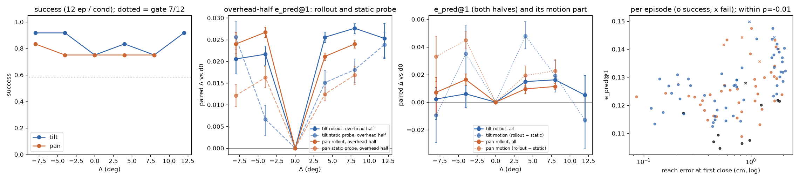

# T012: perception gap in sim — mis-posed overhead camera (H2 extension, stages 0 and A)

Branch `exp/camera-gap` (from `exp/wam-rl-sim-a2` 7cf564c). Outputs are in `/outputs/so101-playground/runs/T012/`:
- `queue/done/*.json`: one result per episode;
- `episodes/*.npz`: per-tick cmd/sent/q, TCP and target-object xy, the static-probe chunks and the rollout's first chunk;
- `episodes/frames/`: contact-sheet frames;
- `server/` (`iw_scores.jsonl` = every score), `logs/`, `analysis.md`, `summary.json`, `gpu_time.log`.

Rows in `/outputs/so101-playground/results.tsv`: `T012A-<cond>` (10 rows). Figures: `docs/T012_camera_gap.png`,
`docs/T012_contact_sheet.png`. Code:
- `src/so101_playground/camera_delta.py`: the knob;
- `reach_error.py`: the reach-error metric;
- `t012_probe.py`: the static probe;
- `t012_coord.py`: the job coordinator;
- `t012_analysis.py`: the analysis;
- `scripts/t009_worker.py`: the T012 additions are opt-in, so T009/T010 runs are unchanged;
- tests in `tests/test_t012.py`.

## Question

The overhead camera is mis-posed, so the policy and the world model both see a shifted view. The questions:
- Does success drop?
- Does InternW0's e_pred rise, and is the rise a static visual floor or motion-related?
- Does e_pred track the task-relevant error (reach error), or only the off-distribution view?

The motivation was home data (InternW0, 6 home bin layouts). An 8° overhead-image warp cut real closed-loop success
from 4/6 to 2/6, and open-loop actions reacted to the view but saturated beyond ~4°. **That home perturbation was not
a camera move.** It was a homography warp of the recorded overhead image (an 8° pitch), which leaves black,
out-of-frame borders where the warped image no longer covers the canvas. Here in sim the camera pose itself changes
and the renderer fills the whole frame, so there are no black borders: the view shifts, but the frame stays fully
populated with real scene content.

## Design

**Knob** (`camera_delta.py`). The bench applies the overhead camera pose at every reset from
`episode_spec.domain_randomization`. The orientation is Rz(yaw)·Ry(pitch)·Rx(roll) in the USD/OpenGL camera frame.
The delta is defined in the camera's own terms and converted back to the bench fields. The wrist camera is untouched.

| knob | definition | bench field | direction (checked by projection and render) |
|---|---|---|---|
| tilt | R·Rx(tilt): about the camera's image-horizontal axis | ≈ `overhead_camera_roll_deg` + tilt (within 0.02°). The bench "roll" (51.36°) is the tilt from vertical. | **+tilt looks further down the table, toward the robot; the scene moves down** (~35 px / 5°) |
| pan | Rz(−pan)·R: about the world vertical (a tripod head) | exactly `overhead_camera_yaw_deg` − pan | **+pan turns the camera right; the scene moves left** (~30–37 px / 5°, f·tan5° = 37 px) |
| roll, x/y/z | about the optical axis; position offset in cm | mixed | not used in stage A |

Contact sheet (`docs/T012_contact_sheet.png`): the first policy frame at d0, tilt ±5° and pan ±5°, with centre
crosshairs. In every job the worker read the camera's local pose back from the sensor after the reset
(`cam_pos_applied`, `cam_quat_applied`), and it matched the requested pose.

**Policy, scoring and the static probe all read the same rendered camera.** e_pred@1 (InternW0-Δ latent 1, ticks
4–16 after each query) is scored at s+16 exactly as in T009/T010. e_pred@2 (latent 2, ticks 20–32) is scored at
s+32. Both go through `/iw_score` on the frames the policy saw.

**Static probe** (`--static_queries 3`). After the reset and the 1.5 s hold, the worker sends 3 `/act` queries at
ticks 45, 61 and 77 with the arm kept docked. The chunks are never executed. Each query is scored @1 and @2 against
the docked frames that follow. Then the env is reset again, so the rollout starts from a fresh reset with the timeout
and physics of a job without a probe.
- **Isolation:** the probe uses trace dir `<run>#<key>.static`, so it gets its own server session and its own
  prediction keys. A CPU test against the real server code checks that the rollout session never sees probe
  observations.
- **Determinism check:** probe query 0 and the rollout's first query see the same scene, each in a fresh session.
  Their chunks differ by a mean |Δa| of 0.08° (max-abs median 0.30°). That is render noise after the re-reset, not
  memory leakage.

**Reach error** (`reach_error.py`) is the XY distance (cm) from the gripper TCP to the centre of the target object's
collision box, at the first commanded jaw close.
- The TCP comes from the bench's `so101_kinematics.tool_pose`, using the measured q and the live base pose.
- The object pose is the live root pose at the close tick.
- **Close event:** the brief's rule (jaw command > 0°, then < −8°). I added a relative rule (open ≥ 20°, then a drop
  of ≥ 20° from the running maximum) because the brief's rule never fires on the 4.5 cm black remote: InternW0
  closes it only from ~38° to ~7°. On T010's 288 recorded episodes:
  - the combined detector fires on every success;
  - only black-pen timeouts never close, and those are counted as "no close";
  - the median successful-grasp reach error is 1.0 cm.
  
  The object hardly moves before the close (0–6·10⁻⁵ cm in the smoke).

**Sweep.**
- Conditions: d0, tilt ±4° and ±8°, pan ±4° and ±8°, plus the gate's 12° follow-up (tilt+12).
- Episodes: 6 home bin layouts × 2 jittered repeats.
- No control gap, no adapter.
- The jitter (±1 cm, ±5°) and episode id 5000 + row are T010's eval draws and the same for every condition. All Δs
  are therefore paired with d0 by (row, rep).
- CIs are 95% percentile bootstraps over the paired episodes (2000 resamples).

## Results



All 120 episodes ran (108 in stage A + 12 at tilt+12). No crashes and no requeues.

### Success: robust up to 12°

| cond | success | pens | Δe_pred@1 (all) | Δe_pred@2 | Δe_pred@1 overhead half | Δstatic probe overhead half | Δstatic probe (all) | Δe_track ° | reach median cm | Δreach cm |
|---|---|---|---|---|---|---|---|---|---|---|
| d0 | 9/12 | 1/4 | (0.127) | (0.189) | (0.037) | (0.062) | (0.272) | (0.65) | 0.86 | — |
| tilt−8 | 11/12 | 3/4 | +0.0023 [−0.0123, +0.0106] | −0.0023 [−0.0163, +0.0063] | **+0.0205** [+0.0171, +0.0226] | +0.0256 [+0.0218, +0.0292] | +0.0118 [−0.0009, +0.0248] | −0.06 [−0.17, −0.01] | 0.58 | +0.16 [−0.09, +0.46] |
| tilt−4 | 11/12 | 3/4 | +0.0060 [−0.0040, +0.0122] | +0.0008 [−0.0081, +0.0074] | **+0.0216** [+0.0191, +0.0235] | +0.0066 [+0.0029, +0.0099] | −0.0290 [−0.0452, −0.0152] | −0.03 [−0.10, +0.01] | 0.58 | −0.01 [−0.30, +0.29] |
| tilt+4 | 10/12 | 2/4 | **+0.0149** [+0.0111, +0.0186] | +0.0172 [+0.0100, +0.0241] | **+0.0256** [+0.0243, +0.0268] | +0.0151 [+0.0122, +0.0179] | −0.0332 [−0.0439, −0.0237] | +0.01 [−0.01, +0.02] | 1.21 | +0.18 [−0.10, +0.50] |
| tilt+8 | 9/12 | 1/4 | **+0.0162** [+0.0137, +0.0187] | +0.0140 [+0.0096, +0.0179] | **+0.0276** [+0.0263, +0.0287] | +0.0181 [+0.0150, +0.0206] | −0.0031 [−0.0134, +0.0081] | −0.01 [−0.02, +0.01] | 0.78 | +0.04 [−0.26, +0.33] |
| tilt+12 | 11/12 | 3/4 | +0.0052 [−0.0145, +0.0195] | +0.0040 [−0.0148, +0.0192] | **+0.0253** [+0.0206, +0.0287] | +0.0238 [+0.0209, +0.0266] | +0.0181 [+0.0056, +0.0299] | −0.09 [−0.22, −0.00] | 0.74 | −0.06 [−0.18, +0.05] |
| pan−8 | 10/12 | 2/4 | +0.0071 [−0.0090, +0.0178] | +0.0112 [−0.0036, +0.0232] | **+0.0240** [+0.0202, +0.0266] | +0.0121 [+0.0095, +0.0147] | −0.0259 [−0.0344, −0.0178] | −0.05 [−0.14, +0.01] | 1.01 | −0.01 [−0.20, +0.19] |
| pan−4 | 9/12 | 1/4 | **+0.0163** [+0.0124, +0.0204] | +0.0207 [+0.0139, +0.0264] | **+0.0267** [+0.0255, +0.0278] | +0.0163 [+0.0139, +0.0188] | −0.0285 [−0.0377, −0.0199] | +0.02 [−0.00, +0.05] | 1.12 | +0.12 [−0.20, +0.39] |
| pan+4 | 9/12 | 1/4 | **+0.0096** [+0.0061, +0.0134] | +0.0103 [+0.0043, +0.0168] | **+0.0211** [+0.0202, +0.0219] | +0.0125 [+0.0109, +0.0140] | −0.0098 [−0.0141, −0.0052] | −0.02 [−0.04, −0.01] | 0.58 | −0.12 [−0.35, +0.09] |
| pan+8 | 9/12 | 1/4 | **+0.0114** [+0.0092, +0.0136] | +0.0104 [+0.0053, +0.0153] | **+0.0240** [+0.0231, +0.0249] | +0.0168 [+0.0147, +0.0188] | −0.0113 [−0.0192, −0.0030] | +0.00 [−0.01, +0.02] | 0.90 | −0.01 [−0.19, +0.20] |

The d0 row shows absolute values in parentheses. Full tables, including per-object outcomes, e_pred_static, the
motion part and arm path, are in `runs/T012/analysis.md`.

- **The four non-pen objects (remote, paintbrush, toothbrush, razor) succeed 8/8 in every condition.**
- Every failure is a pen timeout, and that includes d0. The black pen fails at d0 in both repeats (TT); the red pen
  fails once at d0.
- Pen outcomes flip between conditions (1/4 to 3/4) with no ordering in Δ. tilt−8, tilt−4 and tilt+12 are 11/12,
  above d0's 9/12. With 4 pen episodes per condition this is noise.
- **Stage B gate:**
  - Δ* (smallest |Δ| with success ≤ 7/12) does not exist on either axis up to 8°.
  - Tilt was the more sensitive axis on e_pred: Δe_pred@1 rose monotonically from +0.015 at +4° to +0.016 at +8°.
    Pan was not monotone.
  - **tilt+12 was tried once and gave 11/12, so it did not break success either. The policy is robust to an
    overhead mis-pose up to 12° in sim.**
- e_track does not move (all |Δ| ≤ 0.09°). The gap is visual, as intended.
- Arm path is 1131–1278° against d0's 1225°.

**Open-loop actions react to the view but don't scale with it.** Compare the docked probe's first chunk (identical
state) at Δ with the one at d0, as mean |Δa| over 16 actions and 5 arm joints:
- tilt −8/−4/+4/+8/+12: 0.80 / 1.05 / 1.34 / 0.62 / 0.54°;
- pan −8/−4/+4/+8: 1.18 / 1.19 / 0.88 / 0.86°;
- the render-noise floor is 0.08°.

This reproduces the home observation: about 1° of action change, saturating, or even shrinking, beyond ~4°. Unlike
the home robot, the closed loop absorbs it.

### e_pred: static floor vs motion

**The overhead half of e_pred@1 rises by +0.020 to +0.028 at every Δ.** That is +55–75% on d0's 0.037, and every CI
excludes 0. The rise is a step:
- it is already near full size at 4°;
- it is about the same in both directions and on both axes;
- it hardly grows to 12° (+0.025).

It is an off-distribution-view offset, not a dose response.

The total e_pred@1 rises less and less consistently:
- tilt+ 4/8 and all four pan conditions rise by +0.010 to +0.016 (CIs > 0);
- tilt−4, tilt−8, pan−8 and tilt+12 have CIs that include 0.

In those, the wrist half moves down by about 0.01–0.016. The wrist half is noisier, and in tilt− it may reflect the
more successful, shorter pen episodes. e_pred@2 follows @1.

**The static probe's overhead half rises too** (+0.007 to +0.026, all CIs > 0). So part of the view offset is present
with the arm docked, before any motion: it is a visual floor in the brief's sense.

The probe's total e_pred_static is not a lower bound on the rollout e_pred: d0 gives 0.272 against 0.127.
- The probe chunks command 5–9° of motion that never happens, so most of e_pred_static is "predicted motion vs a
  still scene". This is T011's "first queries are not static" effect.
- The causal VAE makes even a perfectly still clip score e_static ≈ 0.23.

Its paired Δ (total) is mostly negative (−0.010 to −0.033) and not monotone. In those conditions the probe predicts
smaller motion of the docked arm. So the motion part (rollout − static) is not a clean motion-only residual. **Use the
overhead-half Δs (rollout vs probe) as the static/motion split:**
- the probe explains 0.007–0.026 of the rollout's 0.020–0.028 overhead rise;
- the rest is view × motion, i.e. predicting the moving arm in a shifted view;
- that residual is largest at small |Δ| (tilt±4: 0.016/0.010) and near 0 at tilt−8 and tilt+12.

### Does e_pred track the reach error?

| test | Spearman ρ [95% CI] |
|---|---|
| pooled, all conditions and objects (105 episodes with a close; 7 failures) | 0.49 [0.16, 0.57] |
| **within condition and layout** (both residualized on cond + row) | **−0.01 [−0.34, 0.36]** |
| same, motion part / static floor | −0.05 [−0.21, 0.17] / 0.04 [−0.29, 0.32] |
| **paired deltas vs d0** (Δe_pred vs Δreach, n = 90 in 10 blocks) | **−0.03 [−0.24, 0.16]** |
| same, Δmotion / Δstatic | 0.09 [−0.21, 0.30] / −0.09 [−0.32, 0.23] |

The CIs resample whole (row, rep) blocks: 12 blocks, or 10 for the paired deltas, where both black-pen d0 episodes
never close. Every condition reuses the same 12 episodes, and every paired delta shares its block's d0 episode, so the
block is the independent unit (review correction 1).

- The pooled 0.49 is an object effect: the remote and the red pen have both larger reach error (1–2 cm) and larger
  e_pred.
- Within a condition and layout, or within a paired episode, e_pred carries no information about where the gripper
  closes.
- The view shift does not change reach error: every Δreach CI includes 0, and the medians range 0.58–1.21 cm against
  0.86 at d0.

**So the camera mis-pose creates no perception error at the task level, and e_pred's rise is the view only.**

### Failure AUROC (pooled, 22 failures in 120 episodes)

Each score uses the episodes that have it (no imputation). In this run, all 120 episodes have every score, so every
cohort is n = 120 with 22 failures. The CIs resample (row, rep) blocks.

| score | AUROC |
|---|---|
| e_pred@1 | 0.97 [0.87, 1.00] |
| e_pred@2 | 0.98 [0.93, 1.00] |
| e_pred@1 within row + cond | 0.86 [0.67, 0.97] |
| motion part | 0.76 [0.23, 0.99] |
| e_pred_static (probe) | 0.62 [0.42, 0.89] |
| reach error (no close = ∞) | 0.88 [0.56, 1.00] |

The failures are pen timeouts, not camera effects. The black-pen failures (15) never close: the policy dithers above
the pen for 30 s, with e_pred 0.203 against 0.127 for its 5 successes. That dithering is what e_pred detects. The
pre-rollout static probe does not separate outcomes: 0.62, CI includes 0.5.

## Read

- **Success:** an overhead mis-pose of up to 8° on tilt and pan, and 12° on tilt, does not reduce sim success.
  Non-pens stay 8/8 and pen outcomes fluctuate as at d0. **No Δ* exists, so stage B has no gap to learn against in
  sim.** The real home result (8° warp, 4/6 → 2/6) is not reproduced by a pure pose change in sim. Candidate causes,
  not separated here:
  - **The perturbation differs.** At home it was a homography warp of the image, with black out-of-frame borders that
    are far off the training distribution. Here the camera moved and the frame stayed fully rendered, with no
    borders. The warp also distorts the table/bin geometry in a way a rigid pose change does not.
  - The sim scene and background may be more redundant than the real one.
  - The real robot's other gaps compound.
  - Real n = 6 single trials (4/6 vs 2/6) is itself within noise.

  A direct test is to apply the same homography warp, black borders included, to the sim overhead frames: CPU-side
  on the policy input, no new knob.
- **e_pred sees the view, not a perception error:**
  - The overhead half rises by a near-constant +0.02–0.03 at every non-zero Δ, a step, not a dose.
  - Part of the rise is present with the arm docked (static floor). The rest appears only with motion.
  - The rise does not track reach error within conditions or across paired episodes (ρ ≈ 0), because reach error does
    not change.
  - e_pred's strong failure AUROC comes from pen dithering, the same signal as in T009/T010, not from the camera.
- **For RL on the real robot (H2):**
  - A mis-posed camera adds an offset to e_pred: here about +0.01–0.016 in total, a quarter of T010's control-gap
    effect (−0.057).
  - The offset is constant in Δ beyond 4°, so it does not give a gradient toward the correct pose. **e_pred cannot be
    used to recalibrate the camera.**
  - The offset cancels in paired comparisons made at a fixed camera, as in T010's ES. It can bias absolute
    thresholds such as e_pred-based failure detection by about one third of the success/failure gap (0.075 on the
    black pen).
  - Keep the camera fixed during an RL run; if it is bumped, re-baseline.

## Compute

- InternW0 server on GPU 1 (127.0.0.1:18991, `--seed_per_query`); 2 Isaac clients on GPU 0, next to another
  process's 1.8 GB.
- Window 2026-11-28 01:36:37 → 04:50:18: 3.23 h × 2 cards = **6.5 GPU-h** (cap 12), covering smoke + stage A + tilt+12.
- Throughput was ~35 ep/h. Each job took ~20–25 s longer than in T010 because of the probe and the second reset.
- Server and workers are stopped (`queue/STOP`, server killed). GPU 0 is back to the other process's 1.8 GB and
  GPU 1 is empty.

## Reproduce

```bash
R=/outputs/so101-playground/runs/T012
PY=/workspace/so101-playground/.claude/worktrees/wam-control-gap/envs/flux3/flux-action/.venv/bin/python
IW_ENV=/workspace/so101-playground/.claude/worktrees/wam-internw0/envs/internw0 GPU=1 \
    scripts/run_internw0_server.sh 18991 $R/server --seed_per_query --host 127.0.0.1 &
for w in w1 w2; do GPU=0 scripts/run_t009_worker.sh 18991 $R $w --condition none --score_latents 2 & done
cd src
$PY -m so101_playground.t012_coord smoke --root $R                  # contact sheet + 3 short episodes
$PY -m so101_playground.t012_coord sweep --root $R                  # stage A, 108 jobs
$PY -m so101_playground.t012_coord sweep --root $R --conds tilt+12  # gate follow-up
# when done: touch $R/queue/STOP; stop the server
$PY -m so101_playground.t012_analysis --root $R --sheet ../docs/T012_contact_sheet.png
$PY -m so101_playground.t012_analysis --root $R --plot ../docs/T012_camera_gap.png --tsv /outputs/so101-playground/results.tsv
PYTHONPATH=. $PY -m pytest ../tests/test_t012.py -q                 # CPU checks (16 pass, 1 skip)
```

## Review corrections (2026-11-28, codex review; analysis only, no new runs)

1. **Correlation and AUROC CIs now resample whole (row, rep) blocks.** All 10 conditions ran the same 12 (row, rep)
   episodes, and every paired delta shares its block's d0 episode. The earlier version resampled episodes or deltas
   independently, which treated them as independent and gave CIs that were too narrow.
   - The fix is `t012_analysis.block_boot`.
   - Point estimates are unchanged; CIs are wider. Pooled ρ: [0.35, 0.60] → [0.16, 0.57]. Within condition+layout:
     [−0.21, 0.20] → [−0.34, 0.36]. Paired Δ: [−0.24, 0.18] → [−0.24, 0.16]. AUROC e_pred: [0.93, 1.00] → [0.87, 1.00].
     Static probe: [0.51, 0.74] → [0.42, 0.89], now including 0.5.
   - Per-condition paired Δs (the main table) were already correct: within one condition each (row, rep) contributes
     one delta.
2. **Each AUROC now uses its own complete-case cohort,** and n and the failure count are reported (`analysis.md`,
   Cohorts). Before, every score was restricted to episodes with a rollout e_pred@1. The scorer drops the terminal
   window, so an episode that ends early would also have dropped out of the static and reach AUROCs, and a single
   missing e_pred@2 removed the whole @2 AUROC.
3. **Missing probe scores are no longer imputed as 0.** Before, they entered the static/motion correlations and
   AUROCs as 0; now only complete pairs and present scores are used.

   In this run, no episode lacks e_pred@1, e_pred@2 or a probe score, so corrections 2 and 3 change no number here.
   They are covered by `tests/test_t012.py::test_missing_scores_are_not_imputed`.
4. **Doc:** the home 8° result was an image homography warp with black borders, not a camera move. This is listed as
   the first candidate for the sim/home difference (Read).

**Conclusions unchanged:**
- within-condition and paired e_pred~reach correlations are ≈ 0, with CIs including 0;
- the pooled ρ is positive, an object effect;
- e_pred's failure AUROC stays high (0.97 [0.87, 1.00]), driven by pen dithering;
- the static probe does not separate failures.
